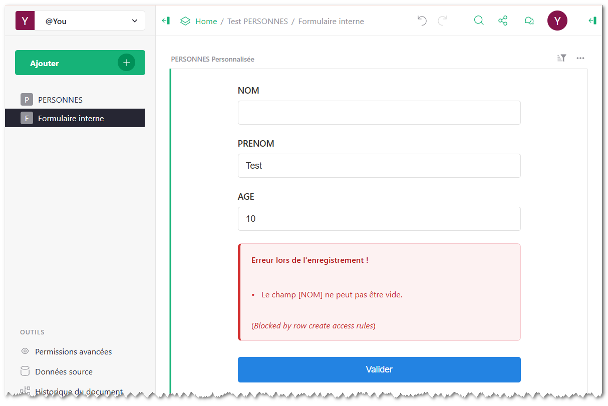
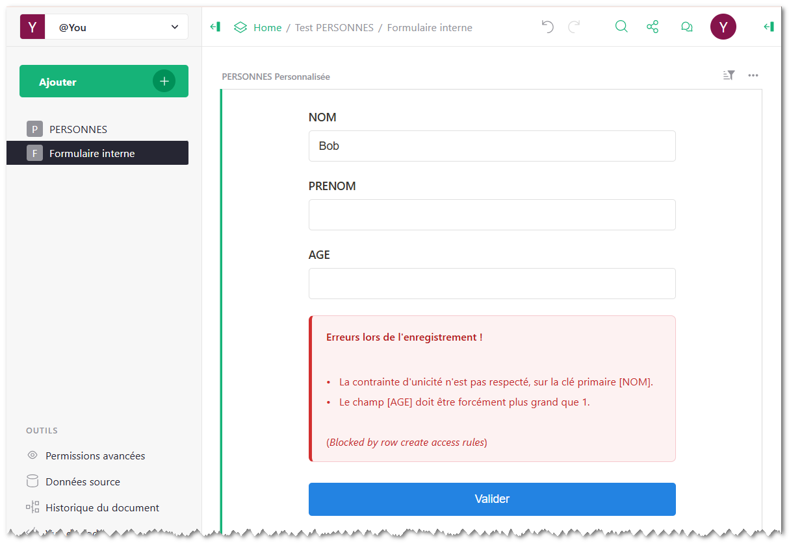
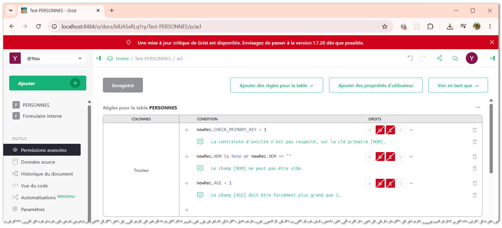
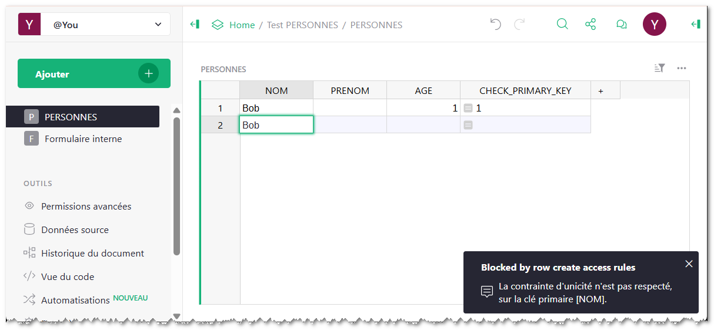

# Fork Upgrade

---

This fork improves form submission feedback by capturing and displaying specific advanced Grist Access Control (ACL) rejection reasons and integrity constraint violations directly to the user.

## Captures & Displays ACL Rejection Reasons


<small>— Capture of a single ACL rejection reason.</small>


<small>— Capture of multiple ACL rejection reasons.</small>

## Summary of Code Improvements

- **Refactored record creation** to use the Grist Fetch API with enhanced error handling and detailed feedback on ACL integrity violations.
- **Refactored error extraction** to cleanly retrieve backend feedback from Grist API responses (including error.details.memos).
- **Improved user error feedback** to display specific advanced access control (ACL) rejection reasons.
- **Secured rendered HTML output using DOMPurify** to prevent XSS vulnerabilities.
- **Improved bloc error styling** to be more user-friendly.


## Under the hood

### Refactored record creation & error handling

When we use `grist.selectedTable.create()` to create a new record on a Grist table, it communicates via the modelisation of the javascript client grist API than making a direct HTTP REST API call. As a result, the error payload returned does not expose the rich backend `error.details.memos` structure standard to the Grist REST API. Instead, it typically returns a generic plugin error (e.g. *Blocked by row create access rules*)
when blocked by ACLs rules thaht modelise the contraints of the table.

To get around this limitation and retrieve detailed ACL rejection memos, you must bypass `grist.selectedTable.create()` and perform a direct `fetch()` call to Grist's REST API endpoint (`POST /docs/${docId}/tables/${tableId}/records`)

### Modeling Integrity Constraints with Grist ACL Rules

For example, let's imagine a table `PERSONS` with columns `[NAME, FIRSTNAME, AGE]`.

To model integrity constraints on this table, you can create ACL rules (Grist advanced permissions) to ensure that the `NAME` column acts as a primary key and can not be empty, or that the AGE column is strictly greater than 1.

| Field                       | ACL Condition | Rejection Memo Message | Constraint Description |
|-----------------------------| --- | --- | --- |
| **Unique Field (`NAME`)**   | `newRec.CHECK_PRIMARY_KEY > 1` | *The uniqueness constraint is not respected on the primary key [NAME].* | Prevents duplicate entries on the `NAME` column. |
| **Required Field (`NAME`)** | `newRec.NAME is None or newRec.NAME == ""` | *The field [NAME] cannot be empty.* | Disallows submitting a record with an empty name. |
| **Value Range (`AGE`)**     | `newRec.AGE < 1` | *The field [AGE] must be greater than 1.* | Ensures that the `AGE` input is strictly greater than 0. |


<small>— Examples of modeling integrity constraints with Grist ACL Rules</small>

To do this, add to the `PERSONS` table, a dedicated formula column named `CHECK_PRIMARY_KEY` with the Python formula: 

```python
len(PERSONNES.lookupRecords(NAME=$NAME))
``` 

It queries the table to retrieve all records matching the `NOM` of the row currently being created or updated. As soon as a duplicate exists in the table, the column `CHECK_PRIMARY_KEY` becomes 2 (or more). The ACL rule can then simply evaluate newRec.CHECK_PRIMARY_KEY > 1 to block the entry and trigger the uniqueness error message.

> Note that if the primary key consists of multiple columns, you just need to adapt the formula like this:
> ```
> len(PERSONNES.lookupRecords(NAME=$NAME, FIRSTNAME=$FIRSTNAME))
> ```

With these advanced Access Control (ACL) rules in place, adding a new row directly within the Grist table with an empty NAME or an invalid AGE instantly triggers the corresponding validation error message. This effectively allows us to model robust SQL-like database integrity constraints (such as *NOT NULL*, *PRIMARY_KEY*, and *UNIQUE*) directly within Grist's architecture, ensuring data quality at the source.


<small>— Example of a unique constraint violation when creating a record in the table</small>